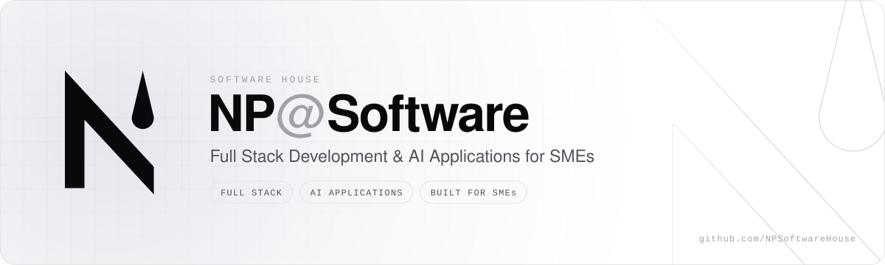
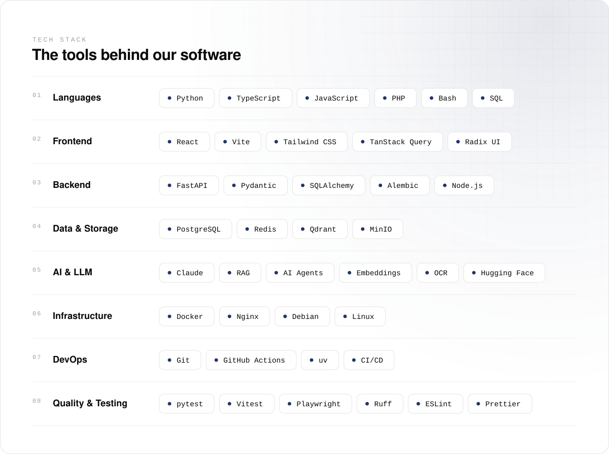

<picture>
  <source media="(prefers-color-scheme: dark)" srcset="https://raw.githubusercontent.com/NPSoftwareHouse/.github/main/profile/assets/banner-dark.svg">
  <source media="(prefers-color-scheme: light)" srcset="https://raw.githubusercontent.com/NPSoftwareHouse/.github/main/profile/assets/banner-light.svg">
  
</picture>

 
 

<picture>
  <source media="(prefers-color-scheme: dark)" srcset="https://raw.githubusercontent.com/NPSoftwareHouse/.github/main/profile/assets/stack-dark.svg">
  <source media="(prefers-color-scheme: light)" srcset="https://raw.githubusercontent.com/NPSoftwareHouse/.github/main/profile/assets/stack-light.svg">
  
</picture>

© 2026 NP@Software

